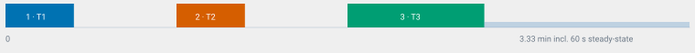
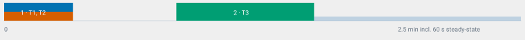
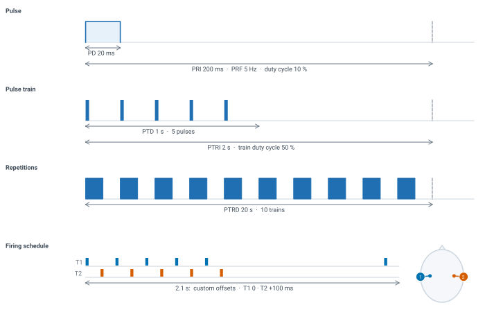
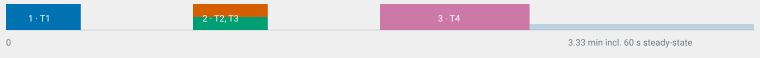

# Async Multi-Transducer Mode

When transducers fire in separate, non-overlapping windows, their fields never interfere, so the coherent sum of [Multi-Transducer Modelling](doc_multitransducer.md) would misstate the exposure. Async mode simulates each transducer on its own, scales each field to its own [I<sub>SPPA</sub>](doc_glossary.md#isppa) target, and combines them: acoustic safety metrics take the per-voxel maximum and heating uses the sum of intensities.

On this page:

- [Async Configuration](#async-configuration): switching on async mode, per-transducer targets, and I<sub>SPPA</sub> sweeps.
- [Physical Model](#physical-model): how the fields are combined for safety metrics and heating.
- [Firing Schedule](#firing-schedule): when each transducer fires, which sets its heating.
- [Example Protocols](#example-protocols): sequences, transducers firing together, interleaved and partly overlapping pulses, and a mixed protocol with uncertainty, as the Nexus shows them.
- [Grid Geometry Mode](#grid-geometry-mode): one shared grid or one grid per transducer.
- [Output Files](#output-files): per-transducer, combined, and joint outputs, resumption, and HPC stages.
- [Constraints](#constraints): required grid, head model, and regime.

!!! note "At a glance"
    - **When you need it:** Transducers fire with non-overlapping duty cycles or alternating pulses, or you want an I<sub>SPPA</sub> sweep across several transducers.
    - **Before you start:** A multi-transducer layered setup as in [Configuration](doc_multitransducer.md#configuration); a 3-D grid.

!!! warning "Experimental"
    For transducers that fire with non-overlapping duty cycles or alternating pulses, so their fields never superpose coherently. Configure it only with a clear view of the intended exposure and the linear-regime assumptions below.

# Async Configuration

Async mode runs when `transducer_coupling` is `'async'` and there is more than one transducer. `prestus_pipeline_start(parameters)` dispatches to it; no other entry point is needed.

```yaml
simulation:
  transducer_coupling: async

transducer:
  - name: CTX500-A
    target_isppa_wcm2: 5.0
    freq_hz: 500000
    trans_pos: [x1, y1, z1]
    focus_pos: [fx1, fy1, fz1]
    annular:
      elem_p_amp: 100000

  - name: CTX500-B
    target_isppa_wcm2: 3.0
    freq_hz: 500000
    trans_pos: [x2, y2, z2]
    focus_pos: [fx2, fy2, fz2]
    annular:
      elem_p_amp: 100000
```

The per-transducer acoustic runs always record a [free-water baseline](doc_glossary.md#free-water-baseline), which the combine step needs for scaling.

**Multi-I<sub>SPPA</sub> sweep.** A vector `target_isppa_wcm2` triggers a sweep.

??? note "Multi-ISPPA sweep"
    Every transducer carries either a scalar (held fixed) or a vector of the same length:

    ```yaml
    transducer:
      - name: CTX500-A
        target_isppa_wcm2: [3.0, 5.0, 10.0]   # swept across 3 points

      - name: CTX500-B
        target_isppa_wcm2: 2.0                  # fixed across all 3 sweep points
    ```

    This gives three combine + thermal pairs (A→3.0, 5.0, 10.0; B→2.0 each time).

# Physical Model

**Acoustic safety metrics (I<sub>SPPA</sub>, MI, peak pressure)** use the per-voxel maximum of the scaled fields. **Thermal heat deposition** follows the [firing schedule](#firing-schedule): each transducer heats with its own scaled field while it is on, and the heat sources of the transducers on at the same time add up.

??? note "Equations"
    Acoustic safety metrics:

    $$p_\mathrm{safety} = \max_i\bigl(p_{i,\mathrm{scaled}}\bigr)$$

    where $p_{i,\mathrm{scaled}} = p_i \cdot \sqrt{I_{i,\mathrm{target}} / I_{i,\mathrm{baseline}}}$. This is `sensor_data.p_max_async` in the combined cache.

    Thermal heat deposition at time $t$:

    $$Q(t) = \sum_{i \in \mathrm{on}(t)} Q_i, \qquad Q_i \propto I_i = \frac{p_{i,\mathrm{scaled}}^2}{2\rho c}$$

    where $\mathrm{on}(t)$ is the set of transducers firing at $t$. The scaled fields are `sensor_data.p_async_tx` in the combined cache. `sensor_data.p_max_all` holds the intensity sum of all transducers on at once, $p = \sqrt{\sum_i p_{i,\mathrm{scaled}}^2}$.

# Firing Schedule

`timing.async_schedule` sets when each transducer fires. Heating follows each transducer's own on-time, so the schedule changes the temperature rise but not the acoustic safety metrics.

| `timing.async_schedule` | Firing | Requires |
|---|---|---|
| `'pulses'` (default) | Every transducer uses the `timing` block; transducer $i$ starts $(i-1)\cdot\mathrm{PRI}/N$ later, so the pulses alternate within each PRI. | $N \cdot \mathrm{PD} \le \mathrm{PRI}$ |
| `'trains'` | Every transducer uses the `timing` block; transducer $i$ starts $(i-1)\cdot\mathrm{PTRI}/N$ later, so the pulse trains alternate. | $N \cdot \mathrm{PTD} \le \mathrm{PTRI}$ |
| `'custom'` | Each transducer starts after its `timing_offset_s` and may override the `timing` block. | No overlap at the same frequency, except within a firing group |

**Transducers that fire together.** With `'custom'`, transducers with the same `timing_offset_s` and the same timing form a firing group. Each still runs its own acoustic simulation and is scaled to its own target I<sub>SPPA</sub>. Their complex fields are then summed, so they interfere, and the group heats in its own windows like a single transducer. One run can therefore mix transducers that fire together with transducers that fire one after another, and [uncertainty mode](doc_uncertainty.md#combining-with-multi-isppa-or-async-modes) wraps it like any async run. A group's peak intensity is not the sum of its members' targets: it depends on their relative phase where the beams overlap. On per-transducer grids (`grid.async_layout: per_transducer`), the complex fields are resampled onto transducer 1's grid with the carrier along each beam removed; the shared grid needs no resampling and is the more accurate choice.

**Pulses that partly overlap.** Transducers at one frequency whose pulses overlap without starting together interfere only while both are on. PRESTUS adds their interference heat in exactly those time segments and takes the peak pressure of the summed field for the safety metrics. `timing.overlap_phase` sets their relative carrier phase: `clock` (default) when the channels share one clock, so the simulated drive phases hold in every pulse; `burst` when each pulse starts its carrier at its own onset, so the phase also shifts with the delay. Ramped pulses (`timing.pulse_ramp_dur`) that partly overlap are not modelled and stop the run.

??? note "Custom schedule"
    ```yaml
    simulation:
      transducer_coupling: async
    timing:
      async_schedule: custom

    transducer:
      - name: CTX500-A
        timing_offset_s: 0
      - name: CTX500-B
        timing_offset_s: 0.1       # first pulse 100 ms after transducer A
        timing:
          pd: 0.04                 # replaces timing.pd for this transducer
    ```

    `transducer(i).timing_offset_s` [s] defaults to 0. `transducer(i).timing` may set `pd`, `pri`, `ptd`, `ptri`, and `ptrd`, so transducers fired one after another can each sonicate for their own duration ([sequences of stances](doc_sequential.md#planning-a-sequence-in-the-nexus)). `post_ptri_dur` and the time steps stay global; the protocol ends `post_ptri_dur` after the last pulse train. Overrides are read only by `'custom'`; with another schedule they are an error.

    Transducers at the same frequency with the same `timing_offset_s` and timing form a firing group; pulses that overlap without starting together interfere while both are on (`timing.overlap_phase`). Within a group, the complex fields (`io.save_p_complex`, set automatically) are summed per frequency; fields at different frequencies heat with their own absorption, and the group's peak pressure is sampled over the pulse as for [transducers at different frequencies](doc_multitransducer.md#transducers-at-different-frequencies). Overlap between groups at different frequencies gives a warning: the summed intensities are right for heating when the pulse is long against 1/|f1 − f2|, but the peak pressure then reaches the sum of the amplitudes at the beat maxima, more than `p_max_all` and MI report.

**Transducers at different frequencies** may fire in separate windows (here) or together ([coherent coupling](doc_multitransducer.md#transducers-at-different-frequencies)). Each transducer's acoustic run uses its own frequency for the time step, PPW, steady-state window and attenuation; a transducer at a frequency other than the first one's maps its own medium on the shared grid. The joint heat source gives each transducer the absorption at its frequency, α(fᵢ) = α(f₁)·(fᵢ/f₁)^y with each tissue's power-law exponent y. MI of the combined field uses the lowest frequency, which never underestimates MI = p/√f.

# Example Protocols

Each example below is one config and one async run, so [uncertainty mode](doc_uncertainty.md#combining-with-multi-isppa-or-async-modes) can wrap any of them. Build them on the Nexus's *Sonication* tab: the *Sonication sequence* card places the steps, and the timing diagram above it shows each transducer's firing lane. The figures are the Nexus's own drawings. Positions are given in MNI mm, so the same config fits any head.

**Stances one after another.** The left stance sonicates for 20 s, then the right stance for 20 s, then the left stance again for 40 s, with 30 s pauses between them. In the card, **Add a later sonication** (then **Add step**) adds a step, **Place in Viewer** sets its stance, and **Pulse timing…** sets the 40 s duration. Each stance gets one acoustic simulation, and step 3 reuses step 1's field because it returns to the same stance. One thermal simulation covers the whole 3.3 min, so each step starts in tissue that the earlier steps warmed.



**Transducers firing together.** Select step 2 and click **Fire with previous step**: T1 and T2 now sonicate at the same time with the same pulses, and T3 follows on its own. The two fields form a firing group. They are summed with their phases, so they interfere where the beams overlap, and each is scaled to its own target I<sub>SPPA</sub> first.



**Interleaved pulses in one train.** Two transducers share the same 1 s pulse trains, and T2's pulses come 100 ms after T1's, so the pulses alternate and never overlap. Set T2's *Start delay* (Transducers tab, advanced coupling fields) to 0.1 s; the *Firing schedule* lanes of the timing diagram show the alternating pulses. The fields never meet in time, so heating adds each field during its own pulses and the peak pressure is the larger of the two.



**A mixed protocol with uncertainty.** T1 sonicates alone, then T2 and T3 converge on a deep target together, then T1 returns to its first stance for 40 s, all with `simulation.uncertainty: true`. Each of the five variants runs the async pipeline with its own tissue properties: three acoustic simulations (T4 shares T1's field), one combine step, and, for the variants that model heating (default, Temp-H, Temp-L), one thermal simulation over the whole protocol. `examples/example_mixed_uncertainty_ernie.m` runs this protocol on SimNIBS' Ernie.



**Partly overlapping pulses.** As above, but T2's pulses come only 10 ms after T1's, so each 20 ms pulse overlaps the other by half. While both are on, the two fields interfere: PRESTUS adds their interference heat in those 10 ms of every pulse and takes the peak pressure of the summed field. Set `timing.overlap_phase` to `burst` if your driver starts each pulse's carrier at its onset rather than on a shared clock.


??? note "The examples as config"
    All of them use `simulation.transducer_coupling: async`, `timing.async_schedule: custom`, `placement.mode: manual` with `placement.manual.coordinate_space: mni`, and the tutorial's timing block (20 ms pulses every 200 ms for 20 s). Only the transducer entries differ; every entry lists the same keys.

    ```yaml
    # Stances one after another: offsets 0, 50, 100 s; step 3 returns to stance 1 for 40 s
    transducer:
      - {serial: CTX_500_026, trans_pos: [-52, -8, 58], focus_pos: [-29, -6, 7], timing_offset_s: 0,   timing: {}}
      - {serial: CTX_500_026, trans_pos: [52, -8, 58],  focus_pos: [29, -6, 7],  timing_offset_s: 50,  timing: {}}
      - {serial: CTX_500_026, trans_pos: [-52, -8, 58], focus_pos: [-29, -6, 7], timing_offset_s: 100, timing: {ptrd: 40}}

    # Firing together: give the transducers of a group the same offset and timing
    #   T1 and T2 at timing_offset_s: 0, T3 at 50

    # Interleaved pulses (timing block: ptd 1, ptri 2): T1 at 0, T2 at 0.1 s
    # Partly overlapping pulses: T1 at 0, T2 at 0.01 s; timing.overlap_phase: clock (default) or burst
    ```

    [`examples/example_mixed_uncertainty_ernie.yaml`](https://github.com/Donders-Institute/PRESTUS/blob/development/examples/example_mixed_uncertainty_ernie.yaml) holds the mixed protocol in full.

# Grid Geometry Mode

| `grid.async_layout` | Grid | Use when |
|---|---|---|
| { .choice-icon } `'shared'` (default) | One grid for all transducers, aligned and cropped as in [Grid alignment](doc_multitransducer.md#grid-alignment) and [Grid cropping](doc_multitransducer.md#grid-cropping). | Default. |
| { .choice-icon } `'per_transducer'` | Each transducer gets the grid a solo run would use. `combine_async_intensity` resamples every field onto transducer(1)'s grid via each run's `planimg` sidecar. | Per-transducer focal distance, I<sub>SPPA</sub>, or focal volume must match a solo run, or the transducers are widely separated or steeply angled. |

??? note "Grid mode choice and accuracy"
    ```yaml
    simulation:
      transducer_coupling: async
    grid:
      async_layout: per_transducer   # default: 'shared'
    ```

    In `shared` mode an off-axis beam is voxelised at an angle, so its per-transducer results can differ from a solo run. The difference shrinks with resolution; at 2 mm (2.5 points per wavelength at 300 kHz) a beam 41° off axis lost 16% of its free-water I<sub>SPPA</sub>. In `per_transducer` mode the resampling (linear interpolation; parts outside transducer(1)'s grid are dropped) costs accuracy instead. `per_transducer` scales better with N: each grid stays sized to its own transducer, at the cost of N preproc jobs.

# Output Files

Two transducers, one target each:

```
cache/sub-001_layered_results_trans-01.mat
cache/sub-001_layered_results_trans-02.mat
cache/sub-001_layered_results_desc-asyncCombined.mat
sub-001_layered_desc-asyncJoint.csv
sub-001_layered_report_desc-asyncJoint.html
```

**Reused acoustic fields.** Transducers with the same stance and settings share one acoustic simulation: a step that returns to an earlier stance reads that stance's field. With positions given in the transducer entries (`placement.mode: manual`), the field is also kept in the output folder as `cache/sub-001_layered_results_ac-<key>.mat`, and later runs with the same settings read it instead of simulating it again: a follow-up run, a repeated study, or the same stance in another sequence. The key covers everything the field depends on (medium and its properties, so each uncertainty variant has its own field; grid; head model; segmentation; backend; with the shared grid, every transducer of the run; and the PRESTUS version), but not the target I<sub>SPPA</sub>, start, or pulse timing. On a cluster, a run planned while another run is still simulating the same field waits for that job. `io.overwrite_files: force` simulates every field again.

??? note "When a field is not kept"
    A field is shared within the run but not kept for later runs when the positions are resolved during the run (placement modes `mni`, `heuristic`, `localite`, `plantus`, `tus_entry`), or when the SimNIBS segmentation does not exist yet when the run is planned. A kept field records the PRESTUS version from the `VERSION` file; after changing the code between runs with the same version, use `io.overwrite_files: force`. The per-transducer outputs at the simulated drive level (CSV, NIfTI) are written by the run that simulated the field.

??? note "Sweep and affix naming"
    A 3-point sweep writes `..._desc-asyncCombinedS01.mat` to `S03` and `sub-001_layered_desc-asyncJointS01.csv` to `S03`.

    With `io.output_affix` (e.g. `run1`), every affix starts with it: `_desc-run1_trans-01`, `_desc-run1_desc-asyncJoint`. The per-transducer runs also write their own CSV and acoustic NIfTIs at the simulated drive level; the Nexus Results tab shows them under the joint result.

**Resumption.** Re-running `prestus_pipeline_start` with the same config resumes from the last incomplete stage. With `io.overwrite_files: always` (default), preproc, acoustic, and combine resume from their caches; the joint and water-validation stages always re-run. `force` re-runs every stage. See [Overwrite behaviour](doc_outputs_reuse.md#overwrite-behaviour).

??? note "Pipeline stages, HPC options, and provenance"
    | Stage | Count | Affix |
    |---|---|---|
    | Preproc | 1 (`shared`) or N (`per_transducer`, parallel) | `_desc-asyncPreproc-t01`, …, `-tNN` (`per_transducer`) |
    | Acoustic, at configured `elem_p_amp`, with water baseline | N (parallel) | `_trans-01`, …, `_trans-NN` |
    | Combine: scale each field to target, write `p_max_all` and `p_max_async` | M sweep points | `_desc-asyncCombined` (M=1) or `_desc-asyncCombinedS01`… |
    | Thermal (`kWaveDiffusion`) and report | M | `_desc-asyncJoint` (M=1) or `_desc-asyncJointS01`… |

    On HPC, each acoustic job depends on its preproc job, each combine job on all N acoustic jobs (`afterok`), and each thermal job on its combine job. `prestus_pipeline_start` returns the job IDs per stage, so later runs can wait on them:

    ```matlab
    [~, jobs] = prestus_pipeline_start(parameters);   % jobs.preproc, .acoustic, .combine, .thermal, .water
    next.hpc.depend_job_ids = [jobs.preproc, jobs.acoustic];
    prestus_pipeline_start(next);
    ```

    HPC options:

    ```matlab
    options.acoustic_timelimit   = '06:00:00';   % per acoustic job
    options.combine_timelimit    = '00:30:00';   % per combine job (CPU-only, lightweight)
    options.thermal_timelimit    = '04:00:00';   % per thermal job
    options.acoustic_memorylimit = 60;           % GB
    options.thermal_memorylimit  = 40;           % GB
    options.acoustic_partition   = 'gpu';
    options.combine_partition    = 'cpu';        % combine stage needs no GPU
    ```

    The combined cache records in `acoustic_provenance`:

    | Field | Description |
    |---|---|
    | `combined_from` | Cell array of source cache file paths |
    | `combination_mode` | `'async_dual_field'`: `p_max_all` holds the thermal intensity sum; `p_max_async` holds the per-voxel pressure maximum for acoustic safety. `'async_dual_field_grouped'`: with firing groups; `'async_dual_field_simultaneous'`: all transducers fire together |
    | `combination_groups` | Firing group of each transducer (with firing groups); `sensor_data.p_async_source_tx` names the transducer whose windows each heat-source field in `p_async_tx` follows |
    | `combination_targets` | Per-transducer target I<sub>SPPA</sub>s used for scaling [W/cm²] |
    | `combination_baselines` | Per-transducer free-water baselines at the simulated drive level [W/cm²] |
    | `combination_time` | Timestamp of the combination step |

# Constraints

- **3-D grid required.** Axisymmetric (2-D) simulations are not supported.
- **Shared head model.** All transducers use the same segmentation (same `subject_id`, `simulation.medium`, and output directory).
- **Linear regime.** The validity conditions of single-transducer I<sub>SPPA</sub> scaling apply (see [Transducer Calibration](doc_calibration.md)).
- **Complex fields between grids.** Transducers that fire together or whose pulses partly overlap are summed as complex fields. On per-transducer grids these are resampled with the carrier along each beam removed, which is exact for a plane wave along the beam and less so in the skull, where the wavelength differs; the shared grid needs no resampling.
- **Uncertainty mode.** With `simulation.uncertainty: true`, each variant runs its own async pipeline (preproc included), and one uncertainty report is written per sweep point. See [Combining with Multi-I<sub>SPPA</sub> or Async Modes](doc_uncertainty.md#combining-with-multi-isppa-or-async-modes).
