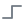

# Head Model and Grid Parameters

These parameters turn the MRI into the simulation medium: segmentation, head-model preprocessing, pseudo-CT, tissue layers and properties, and the simulation grid.

On this page:

- [Segmentation (`segmentation`)](#segmentation-segmentation): options passed to SimNIBS [charm](https://simnibs.github.io/simnibs/build/html/documentation/command_line/charm.html), and defacing.
- [Head Model & Segmentation Preprocessing (`headmodel`)](#head-model-segmentation-preprocessing-headmodel): padding and mask preprocessing of the head model.
- [Pseudo-CT Skull Property Mapping (`pct`)](#pseudo-ct-skull-property-mapping-pct): pseudo-CT generation and its mapping to skull properties.
- [Tissue Layers (`layers`)](#tissue-layers-layers): which segmentation labels form each tissue layer.
- [Tissue Acoustic & Thermal Properties (`medium_properties`)](#tissue-acoustic-thermal-properties-medium_properties): per-tissue acoustic and thermal properties.
- [Simulation Grid (`grid`)](#simulation-grid-grid): resolution, dimensions, axisymmetric mode, and PML.

## Simulation Grid (`grid`)

| **Parameter** | **Description** | **Default** | **Comments** |
|---|---|---|---|
| `resolution_mm` | Grid resolution (must be isotropic) [mm]. | `0.5` | |
| `default_dims` | Requested grid dimensions [voxels per dimension], or `'auto'`. | `'auto'` | Directly sets the simulation grid for `water` and `phantom` media (a phantom uses its own size unless it matches). For `layered`, the grid is determined by head preprocessing and this value is not used. `'auto'` (water only, `water_grid_dims`) sizes the grid to the transducer, as the acoustic FOV of a head simulation: aperture + 2 × `water_margin_mm` (default 5 mm) laterally, focal distance from the bowl + `z_beyond_focus_mm` (default 40 mm) axially; `[Nlateral, Naxial]` with `axisymmetric`. For the shipped transducers this is 15–80 % of the points of `[144, 144, 400]` with the same free-water ISPPA (within 0.003 %) and focus (k-Wave drive benchmark). A non-annular (matrix) transducer placed by `trans_pos`/`focus_pos`, which are grid indices, keeps `[144, 144, 400]` (`[144, 400]` axisymmetric) with a warning. |
| `axisymmetric` | Run axisymmetric 2D simulation (`kspaceFirstOrderAS`). | `0` | `1 = yes`, `0 = no`. See [Acoustic Simulations](doc_simulations-acoustic.md). |
| `axisymmetric_output` | Form of axisymmetric results. | `'auto'` | `'auto'`: expanded to 3D for `phantom` media or when heating is requested, otherwise the mirrored 2D plane. { .choice-icon } `'2d'`: always the plane (not with heating); for fine grids, where the 3D expansion would not fit in memory. { .choice-icon } `'3d'`: always expanded. |
| `mode` | Grid orientation before cropping. | `'focal_axis'` | { .choice-icon } `focal_axis`: rotate so the mean beam axis of all transducers (beams averaged as axes) is z. { .choice-icon } `transducer_axis`: focal axis of transducer 1. { .choice-icon } `ras_plus`: no rotation, only rescaling. (`principal_axis` was removed and errors.) See [Head preprocessing](doc_head-model.md#orientation). |
| `async_layout` | Async coupling: one grid or one per transducer. | `'shared'` | { .choice-icon } `shared`: one grid for all transducers, oriented by `mode`. { .choice-icon } `per_transducer`: one grid each, as a solo run would use (parallel on HPC). See [Grid Geometry Mode](doc_multitransducer_async.md#grid-geometry-mode). |
| `focal_axis_min_norm` | Fallback threshold of `focal_axis` mode. | `0.5` | When the mean beam-axis vector is shorter than this (beam axes too spread; only possible with three or more transducers), transducer 1's axis is used. |
| `pml_size` | Perfectly Matched Layer (PML) size [voxels]. | `'auto'` | `'auto'` chooses a size that keeps FFT grid sizes small-prime (k-Wave `getOptimalPMLSize`); a number fixes it. Absorbs waves at boundaries. Recommended for 3D. See [k-Wave docs](http://www.k-wave.org/documentation/example_na_controlling_the_pml.php). For jwave, `'auto'` is about 2.5 wavelengths instead (see [jwave PML size](doc_jwave_configuration.md#pml-size)). |
| `water_baseline_grid` | Grid of the k-Wave free-water baseline (ISPPA targeting). | `'beam'` | { .choice-icon } `'beam'`: the box around the source and each beam axis from the bowl to 40 mm beyond the deeper of focus and geometric focus, +10 mm (WATER_BASELINE_BOX); in water nothing outside reflects back, so the free-field result is the same at a fraction of the cost. { .choice-icon } `'full'`: the whole simulation grid. jwave and axisymmetric runs use the full grid. |
| `pml_size_range` | Search range `[min, max]` of `pml_size: 'auto'` [grid points]. | `[10, 40]` | Passed to k-Wave's `getOptimalPMLSize`, which picks the FFT-friendliest size in the range. A thicker layer absorbs better at grazing incidence and costs grid points. |
| `pml_alpha` | PML absorption [Nepers per grid point]. | `[]` | Empty: k-Wave's default (2). Passed as k-Wave's `PMLAlpha`. |
| `source_ppw` | Points per wavelength (PPW) override. | `[]` | Calculated internally from `resolution_mm` and the medium's maximum sound speed if not set. Setting this overrides the internal calculation and fixes the number of spatial samples per wavelength used to derive the time step. |
| `min_ppw` | Minimum acceptable PPW at the fundamental frequency. | `6` | Checked against the slowest medium sound speed (worst-case spatial sampling). A warning is raised if the actual PPW falls below this value, along with the maximum `resolution_mm` that would satisfy it. |
| `source_cfl` | Courant-Friedrichs-Lewy (CFL) fraction. | `0.15` | Controls temporal resolution independently of spatial resolution. Given a fixed spatial step `dx`, the time step is `dt = CFL × dx / c_max`, where `c_max` is the fastest medium sound speed (typically skull at ~2800 m/s). Smaller CFL = finer temporal sampling and must remain below the stability limit. Set to 0.15 (half k-Wave's default of 0.3) for additional stability margin in heterogeneous skull simulations. Can be relaxed toward 0.3 to reduce runtime, but should be validated against `checkStability` output. |
| `source_limit_fraction` | Fraction of the stability limit to use for time step. | `0.9` | After source setup, `checkStability` is called; if the CFL-derived `dt` exceeds the estimated limit, source setup reruns with `dt = source_limit_fraction × dt_stability_limit`. The final effective `dt` may therefore be smaller than `CFL × dx / c_max`. Set to `0` to disable. |
| `steady_state_transits` | Number of domain-diagonal one-way transits (at min. sound speed) before recording starts. | `1` | Total simulation duration is `transits × diagonal / c_min`. Compact, highly reflective domains (e.g. a partial-FOV crop with a high skull/water impedance mismatch, ~50% reflection coefficient for typical skull properties) may need more than one transit for multiply-reflected energy to decay to true periodic steady state. jwave's own cross-validation test uses `roundtrips=20`. |
| `steady_state_num_periods` | Number of trailing wave periods recorded as the steady-state window. | `3` | `sensor.record_start_index` is set so the last `num_periods` periods of the simulation are recorded for `p_max_all`/`p_min_all`/`p_final`. Increase together with `steady_state_transits` if reported Isppa/focal depth are still drifting as either is increased; a converged setup should stop changing further. |
| `bli_tolerance` | kWaveArray band-limited interpolation (BLI) tolerance. | `[]` | Empty: 0.1 (3D), 0.01 (axisymmetric). Smaller values keep more of the sinc tails (more source grid points). |
| `bli_upsampling_rate` | kWaveArray integration points per grid point. | `[]` | Empty: 10 (3D), 100 (axisymmetric). |
| `source_ppp` | Time steps per wave period (PPP) override. | `[]` | When set, `dt = period / source_ppp`; `source_ppw` and `source_cfl` are not used. For matching a reference simulation's time step (e.g. the [ITRUSST](https://itrusst.org/) k-Wave references). The stability recheck (`source_limit_fraction`) still applies. |
| `sim_time_us` | Fixed simulation duration [µs]. | `[]` | When set, replaces `steady_state_transits` (and jwave's PML margin); the last `steady_state_num_periods` periods of this duration are recorded. |
| `max_expand` | Maximum grid expansion for prime-number FFT optimisation [voxels]. | `40` | |
| `use_kWaveArray` | Use the kWaveArray class for transducer modelling? | `1` | `1 = yes`, `0 = no` |
| `acoustic_fov_diameter_mm` | Lateral extent of the acoustic simulation FOV [mm], centred on the beam axis. When set together with `acoustic_fov_length_mm`, the acoustic simulation runs on a cropped sub-grid rather than the full head grid. Thermal simulation runs on the full head grid unless `thermal_use_acoustic_fov: 1`. | `[]` | Optional. `'auto'`: the outer element diameter of `transducer(1)` plus 4 voxels per side; a smaller numeric value is enlarged to that with a warning. See [Partial FOV](doc_partial-fov.md). |
| `acoustic_fov_length_mm` | Axial extent of the acoustic simulation FOV [mm], starting from the bowl apex (`trans_pos`) and extending distally. Must be large enough to enclose the focus and any near-field region of interest. | `[]` | Optional. Requires `acoustic_fov_diameter_mm`. `'auto'`: the `trans_pos`-to-`focus_pos` distance + `z_beyond_focus_mm`. See [Partial FOV](doc_partial-fov.md). |
| `thermal_use_acoustic_fov` | Run the thermal simulation within the acoustic FOV instead of the full grid. | `0` | `1` is faster, with a less accurate cooling boundary. See [Partial FOV](doc_partial-fov.md). |
| `thermal_resolution_mm` | Grid resolution for the thermal simulation [mm]. When set to a value larger than `resolution_mm`, the acoustic pressure field is resampled to a coarser grid before thermal simulation, reducing memory and runtime. Heating and CEM43 maps are mapped back onto the acoustic grid (each thermal voxel's value kept). 3-D grids only. | `[]` | Optional. Defaults to `resolution_mm` (same grid). |
| `origin_ras_mm` | Phantom and water grids: RAS position of voxel [1,1,1] [mm]. | *(not set)* | Output NIfTIs get a diagonal RAS affine from it and `resolution_mm`, so they open in place in viewers; the simulation is unaffected. See [Coordinate Reference Systems](doc_coordinate_systems.md). |
| `thermal_fov_mm` | Spatial extent of the thermal simulation domain [mm], as a `[1×3]` vector `[x y z]`. When set, the thermal grid is cropped to a box of this size centred on the focus. Unlike the acoustic FOV crop, the thermal FOV has no physical justification for excluding regions: heat diffuses well beyond the focal zone, and cropping can underestimate temperature rise in neighbouring tissue. Use only for rapid prototyping, not for safety-critical results. Outside the box, the heating maps hold the baseline temperature and CEM43 maps zero. 3-D grids only. | `[]` | Optional. See [Partial FOV](doc_partial-fov.md). |

---
## Segmentation (`segmentation`)

| **Parameter** | **Description** | **Default** | **Comments** |
|---|---|---|---|
| `use_qform` | Force qform reorientation before charm segmentation? | `0` | Set to `1` if charm reports a qform/sform mismatch error. |
| `debug` | Pass `--debug` to charm for verbose segmentation output? | `0` | `1 = yes`, `0 = no` |
| `noneck` | Pass `--noneck` to charm: the scan contains no neck. | `0` | `1 = yes`, `0 = no` |
| `settings_file` | charm settings file (`.ini`), passed as `--usesettings`. | `''` | `''` = the `charm.ini` of the SimNIBS install. Start from a copy of that file. Keep it outside the m2m folder, which charm deletes when it re-runs. |
| `deface` | Create a defaced copy of the SimNIBS m2m folder (`m2m_sub-NNN_defaced/`) for safe sharing? | `0` | `1 = yes`, `0 = no`. Made again when the segmentation changes. See [Defaced copy for sharing](doc_segmentation.md#defaced-copy-for-sharing). Runs [`pydeface`](https://github.com/poldracklab/pydeface) (must be installed in `startup.simnibs_bin_path`) on T1, UTE, bias-corrected, and MNI-space anatomical images. The original m2m folder is never modified. Only affects saved files; see `io.deface_plots` for figure defacing. |

---
## Head Model & Segmentation Preprocessing (`headmodel`)

See [Head Model](doc_head-model.md).

| **Parameter** | **Description** | **Default** | **Comments** |
|---|---|---|---|
| `head_pad_mm` | Symmetric padding of the rotated head volume before CSF expansion and cropping [mm]; bowls outside the volume are auto-padded. | `0` | |
| `csf_expansion` | Dilation of the CSF brain mask into surrounding head regions, along each axis [mm]. | `20` | Converted to voxels at the grid resolution (`preproc_crop_eCSF`). |
| `smooth_method` | Mask smoothing filter type. | `'gaussian'` | { .choice-icon } `gaussian`: isotropic blur, smooth edges, moderate erosion. { .choice-icon } `box`: uniform kernel, fastest, blocky, prone to skull holes. { .choice-icon } `off`: raw mask, no filtering or binarisation. See [Layer mapping and smoothing](doc_head-model.md#layer-mapping-and-smoothing). |
| `smooth_threshold_skull` | Binarisation threshold for skull mask; higher = thinner mask. | `0.5` | |
| `smooth_threshold_other` | Binarisation threshold for other masks; higher = thinner mask. | `0.5` | |
| `smooth_fwhm_mm` | FWHM of smoothing kernel [mm]. | `1` | Converted to voxels at the grid resolution, not the T1 resolution. |
| `smooth_properties` | Apply smoothing to acoustic property maps as well? | `false` | |
| `skull_fill_method` | Method for filling holes in the skull. | `'rubberwrap'` | { .choice-icon } `rubberwrap` / { .choice-icon } `imclose` / { .choice-icon } `off` (skull as segmented, e.g. for animal or phantom label volumes). Filled holes become cortical skull. |
| `skull_wrap_radius_mm` | Rubber-wrap radius [mm]. | `5` | The wrap bridges skull holes up to about twice this width where brain meets skin; larger fills wider holes. Replaces `skull_wrap_radius` [grid voxels], which is converted at the run's `grid.resolution_mm`. |
| `skull_wrap_visualize` | Visualize rubber-wrap result? | `0` | `1 = yes`, `0 = no`. Avoid on HPC. |
| `reuse_across_placements` | Build the smoothed head model once per subject and only rotate and crop it for each transducer placement. | `false` | Saves the smoothing and hole filling (most of head preprocessing at fine resolution) in every run after the first of a subject: other poses, aims, or affixes in the same output folder. Cached as `<dir_cache>/sub-XXX_<medium>_headmodel_<res>mm.mat` with the settings it depends on; rebuilt when they change. With `grid.mode: ras_plus` the result equals per-placement preprocessing exactly (checked on one head, two poses). With a rotated mode the smoothing precedes the rotation and the labels are resampled once more (nearest neighbour), which changes thin skull layers (skull-layer Dice 0.80–0.90 against per-placement preprocessing at 1 mm; a warning says so). Needs the planning T1 and the segmentation on one voxel grid. |

### Air-Cavity Check (`headmodel.air_cavities`)

See [Air-Cavity Check](doc_head-model.md#air-cavity-check).

| **Parameter** | **Description** | **Default** | **Comments** |
|---|---|---|---|
| `source` | Where the internal air cavities come from. | `'simnibs'` | `none`: off. `simnibs`: the charm Air-Internal label (`simnibs_labels`) from `segmentation/labeling.nii.gz` in the m2m folder. `segmentation`: voxels with the labels in `labels`. `hu`: CT or pseudo-CT voxels in `hu_window`; needs `pct.enabled: 1`. Layered medium only. |
| `simnibs_labels` | Label indices of internal air in the charm labelling. | `[501]` | `source: simnibs`. 501 is Air-Internal in `segmentation/labeling_LUT.txt` (SimNIBS 4.0 to 4.6). |
| `labels` | Segmentation label indices of internal air. | `[]` | Required with `source: segmentation`, for a segmentation that labels air. SimNIBS `final_tissues.nii.gz` has no air label (internal air is 0); use `source: simnibs`. Label 0 (background) is not allowed. |
| `hu_window` | HU range classified as air. | `[-1200, -400]` | `source: hu`. As `babelbrain.air_hu_window`. |
| `keep_boundary` | Keep air components that touch the grid edge. | `false` | `source: hu`. By default they are removed with the air around the head. |
| `warn_db` | Flag the run when the peak pressure inside a cavity exceeds this level relative to the brain peak [dB]. | `-6` | |
| `warn_beam_fraction` | Flag the run when, at any depth before the focus, cavities fill more than this share of the −6 dB beam cross-section. | `0.1` | Between 0 and 1. |

---
## Pseudo-CT Skull Property Mapping (`pct`)

See [CT-Based Skull Mapping](doc_pseudoCT.md).

| **Parameter** | **Description** | **Default** | **Comments** |
|---|---|---|---|
| `enabled` | Map skull properties from a CT? | `0` | `1 = yes`, `0 = no`. Reads the measured CT in `path.ct_pattern`; when that is empty, a pseudo-CT is generated from the UTE image (`path.t2_pattern`) if not already present in the pseudo-CT folder. |
| `skull_mapping` | UTE→HU linear mapping algorithm used during pseudo-CT generation (not with a measured CT). | `'kosciessa'` | `kosciessa` / `miscouridou` / `wiesinger` / `treeby` / `custom`; `carpino` is deprecated. See [Choosing the UTE-to-HU Mapping](doc_pseudoCT_generation.md#choosing-the-ute-to-hu-mapping). |
| `custom_slope` | Slope of the `custom` UTE→HU map (HU per normalised UTE unit). | `[]` | Scalar; required when `skull_mapping` is `custom`. |
| `custom_intercept` | Intercept of the `custom` UTE→HU map [HU]. | `[]` | Scalar; required when `skull_mapping` is `custom`. |
| `debug` | Keep intermediate NIfTI files in the `debug_pct/` subfolder of the pseudo-CT folder. | `1` | `1 = keep`, `0 = delete after generation`. |
| `mapping_density` | HU-to-density mapping algorithm. | `'k-plan'` | `k-plan` / `k-wave` / `marsac` / `marsac-babelbrain` / `aubry` / `air-tissue` / `none`. See [Mapping Skull Density](doc_pseudoCT_property-mappings.md#mapping-skull-density). |
| `density_calibration` | HU-to-density table for `mapping_density: k-plan`; use the table of the measured CT, or of the CT the UTE→HU line was fitted to. | `''` | `''` ([k-Plan](https://k-plan.io/) default) / `ucl_lowdose_80kvp` (for `treeby`) / `cph2025` / path to a CSV (HU, density [kg/m³]). See [Mapping Skull Density](doc_pseudoCT_property-mappings.md#mapping-skull-density). |
| `mapping_soundspeed` | HU-to-sound-speed mapping algorithm. | `'k-plan'` | `k-plan` / `marsac` / `aubry` / `webb` / `pichardo` / `mcdannold` / `none`. See [Mapping Skull Sound Speed](doc_pseudoCT_property-mappings.md#mapping-skull-sound-speed). |
| `mapping_attenuation` | HU-to-attenuation mapping algorithm. | `'k-plan'` | `k-plan` / `mueller` / `aubry` / `webb` / `pichardo` / `mcdannold` / `none`. See [Mapping Skull Attenuation](doc_pseudoCT_property-mappings.md#mapping-skull-attenuation). |
| `interpolation` | Resampling of the CT onto the simulation grid. | `'linear'` | `linear` / `cubic` (cubic convolution) / `spline` (interpolating cubic spline, as BabelBrain). Cubic and spline overshoot at bone edges; the HU limits clip the overshoot. See [Limits and Interpolation](doc_pseudoCT_property-mappings.md#limits-and-interpolation). |
| `limits.hu_min` | Lower HU limit of the CT [HU]. | `[]` | `[]` = none. Acts before the skull is defined and mapped. |
| `limits.hu_max` | Upper HU limit of the CT [HU]. | `[]` | `[]` = none. BabelBrain CT: 2100. |
| `limits.density_min` | Lower limit of the mapped skull density [kg/m³]. | `'water'` | A number, `water` (the water density), or `[]`. |
| `limits.density_max` | Upper limit of the mapped skull density [kg/m³]. | `[]` | A number, `water`, or `[]`. |
| `limits.sound_speed_min` | Lower limit of the mapped skull sound speed [m/s]. | `'water'` | A number, `water`, or `[]`. |
| `limits.sound_speed_max` | Upper limit of the mapped skull sound speed [m/s]. | `[]` | A number, `water`, or `[]`. |
| `limits.alpha_coeff_min` | Lower limit of the mapped skull attenuation [dB/(cm MHz^y)]. | `[]` | A number, `water`, or `[]`. |
| `limits.alpha_coeff_max` | Upper limit of the mapped skull attenuation [dB/(cm MHz^y)]. | `[]` | A number, `water`, or `[]`. |
| `hu_reference_layers` | Layers whose CT values over the whole head set the densest-bone HU. | `['skull']` | For mappings that scale by it: density `marsac-babelbrain` and `aubry`, sound speed `aubry`, attenuation `mueller` and `aubry`. See [The HU Reference](doc_pseudoCT_property-mappings.md#the-hu-reference). |
| `hu_reference_percentile` | Percentile of the CT in `hu_reference_layers` taken as the densest bone. | `99.9` | `100` = the largest HU. Below 100, single bright voxels (metal, artefacts) do not set the scale. |
| `hu_reference_resolution_mm` | Grid on which the densest-bone HU is taken [mm]. | `[]` | `[]` = the segmentation grid. A spacing = after resampling the whole-head CT onto that grid with `interpolation`, as BabelBrain does. Not recommended outside tool comparisons: spline overshoot raises the reference. See [The HU Reference](doc_pseudoCT_property-mappings.md#the-hu-reference). |
| `bone_source` | Where the skull is. | `'segmentation'` | `segmentation`: the segmentation's skull labels, with `headmodel.skull_fill_method`. `hu`: voxels whose HU exceed `bone_hu_threshold` on the simulation grid, as BabelBrain's CT path; needs `enabled: 1`. `mask`: a bone mask file (`path.bone_mask_pattern`). See [Skull from the CT](doc_pseudoCT.md#skull-from-the-ct). |
| `bone_hu_threshold` | HU above which a voxel is bone (`bone_source: hu`) and below which bone HU are raised to it (`hu` and `mask`) [HU]. | `300` | BabelBrain: 300. |
| `bone_median_mm` | Width of the median filter of the bone mask (`bone_source: hu` or `mask`) [mm]. | `0` | `0` = off. BabelBrain: 7 voxels (2.6 mm at 6 PPW, 500 kHz). |
| `bone_open_mm` | Edge of the cube that opens the bone mask before the closing, removing specks and spurs narrower than the cube (`bone_source: hu` or `mask`) [mm]. | `0` | `0` = off. |
| `bone_close_mm` | Edge of the cube that closes holes in the bone mask (`bone_source: hu` or `mask`) [mm]. | `0` | `0` = off. BabelBrain: 5. |
| `bone_soft_layer` | Medium that segmentation skull voxels outside the bone mask join (`bone_source: hu` or `mask`). | `'nearest'` | `nearest`: the medium of the nearest voxel outside both skull definitions (skin on the outer side, brain or CSF on the inner). Or a layer of the run, for all of them. |
| `soft_hu_threshold` | HU that separates soft tissue from water on the simulation grid, outside the skull: tissue below it becomes water, water at or above it takes the nearest soft tissue [HU]. | `[]` | `[]` = off: the segmentation decides. Needs `enabled: 1`. See [Soft Tissue from the CT](doc_pseudoCT.md#soft-tissue-from-the-ct). |
| `webb_sos_slope` | Slope of the `webb` sound-speed line [m/s per HU]. | `[]` → `0.75` | Not in `config_default.yaml`; set for your scanner from Webb et al. (2018), Tables I and II. `[]` = GE 120 kVp, B kernel. |
| `webb_sos_intercept` | Intercept of the `webb` sound-speed line [km/s]: c = slope · HU + 1000 · intercept [m/s]. | `[]` → `1.32` | As `webb_sos_slope`. |
| `webb_att_alpha0` | α₀ of the `webb` attenuation model α₀ · exp(c · HU). | `[]` → `26` | Not in `config_default.yaml`; set for your scanner from Webb et al. (2021), Table IV. `[]` = GE 120 kVp, B kernel. |
| `webb_att_beta` | Frequency exponent β of the `webb` attenuation model; used as the skull `alpha_power`. | `[]` → `1.3` | As `webb_att_alpha0`. |
| `webb_att_c` | Exponent coefficient c of the `webb` attenuation model [1/HU]. | `[]` → `-0.0016` | As `webb_att_alpha0`. |

---
## Tissue Layers (`layers`)

See [Head Model](doc_head-model.md).

Maps tissue compartment names to their SimNIBS charm label indices. Compartments are modelled in listed order; any voxel label not assigned to a named compartment is treated as water. Charm label values are hardcoded in `charm_seg_labels()`. Layers can be removed or added.

| **Layer** | **Default charm labels** | **Comments** |
|---|---|---|
| `water` | `[0, 3, 6, 9, 10]` | Baseline layer; all unassigned voxels are treated as water |
| `brain` | `[1, 2]` | White matter + grey matter |
| `skin` | `[5]` | |
| `skull` | `[4]` | Single skull layer; used when cortical/trabecular split is not needed |
| `skull_cortical` | `[7]` | Cortical bone; used in multi-layer skull model |
| `skull_trabecular` | `[8]` | Trabecular bone; used in multi-layer skull model |

---
## Tissue Acoustic & Thermal Properties (`medium_properties`)

See [Medium Properties](doc_medium.md).

Each tissue compartment (`water`, `brain`, `skin`, `skull`, `skull_trabecular`, `skull_cortical`) carries the following fields:

| **Field** | **Description** | **Units / Reference** |
|---|---|---|
| `sound_speed` | Speed of sound. | m/s; source: ITRUSST benchmarks |
| `density` | Density. | kg/m³; source: ITRUSST benchmarks |
| `alpha_coeff` | Attenuation coefficient. | dB/cm/MHz |
| `alpha_power` | Attenuation power law exponent. | dimensionless |
| `thermal_conductivity` | Thermal conductivity. | W/m/°C; source: [Tissue Properties DB](https://itis.swiss/virtual-population/tissue-properties/database) |
| `specific_heat_capacity` | Specific heat capacity. | J/kg/°C; source: Tissue Properties DB |
| `perfusion` | Perfusion / heat transfer rate. | mL/min/kg; source: Tissue Properties DB |
| `absorption_fraction` | Fraction of attenuation converted to heat. Set this or `absorption_coeff`; a config layer that sets one empties the other ([Heat deposition](doc_simulations-thermal.md#heat-deposition)). Default for every tissue. | [0–1]; source: [Pinton et al., 2012](https://doi.org/10.1118/1.3668316) |
| `absorption_coeff` | Absorption coefficient, with the power law `alpha_power`; empty by default. Set this or `absorption_fraction`. | dB/cm/MHz; source: Pinton et al., 2012 |

---
