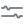

# Simulation and Sonication Parameters

These parameters choose the medium type and solvers, the sonication timing, the thermal model, and the output analysis.

On this page:

- [Simulation Type (`simulation`)](#simulation-type-simulation): medium, [k-Wave](https://github.com/ucl-bug/k-wave) code type, precision, interactive mode, live view, debug mode, transducer coupling.
- [Simulation Backends (`acoustic_backend`, `thermal_backend`)](#simulation-backends-acoustic_backend-thermal_backend): which solver runs the acoustic and thermal steps, and its settings.
- [Sonication Timing (`timing`)](#sonication-timing-timing): pulse and pulse-train durations and repetition intervals.
- [Thermal Settings (`thermal`)](#thermal-settings-thermal): CEM43 variant, baseline temperatures, and thermal sensor and logging.
- [Output Analysis (`analysis`)](#output-analysis-analysis): focus-area radius and MNI target or ROI for analysis.

## Simulation Type (`simulation`)

| **Parameter** | **Description** | **Default** | **Comments** |
|---|---|---|---|
| `medium` | Simulation medium type. | `'layered'` | { .choice-icon } `water` / { .choice-icon } `layered` / { .choice-icon } `phantom`. Mandatory. |
| `code_type` | k-Wave backend. | `'matlab_gpu'` | `matlab_cpu` / `matlab_gpu` / `cpp_cpu` / `cpp_gpu` / `cpp_mlx`. See [k-Wave](doc_kwave.md). |
| `precision` | Computational precision for acoustic and thermal simulations. | `'single'` | `single` / `double` |
| `interactive` | Interactive mode with prompts and evolving plots. | `0` | `1 = yes`, `0 = no`. If `0`, see `overwrite_files`. |
| `live_view` | Plot the evolving pressure and temperature fields without prompts, also in batch and cluster runs, and save them every 5 s in `live/` in the output folder: a field plane as `<stage>_sub-<id><affix>.f32` and `.json`, or, for the k-Wave MATLAB pressure field, its figure as `.png`. The Nexus shows these frames while the run is going. | `0` | `1 = yes`, `0 = no`. Pressure frames need a k-Wave MATLAB solver (`matlab_cpu`, `matlab_gpu`, or the elastic model) BabelBrain with CUDA, or jwave; not the k-Wave C++ solvers. Slows the k-Wave solvers down; jwave Helmholtz then solves in chunks of GMRES restarts. |
| `debug` | Verbose debug mode with additional intermediate outputs. | `0` | `1 = yes`, `0 = no`. Outputs go to `debug/` and are listed in the [debug report](doc_outputs.md#debug-outputs). |
| `debug_stages` | Stages that write debug outputs. | `all` | `all`, or a list of `preproc`, `medium`, `source`, `babelbrain`. |
| `debug_figures` | Write diagnostic figures (PNG). | `1` | `1 = yes`, `0 = no`. 3D figures are saved from three angles. |
| `debug_volumes` | Write intermediate volumes (NIfTI). | `1` | Each is about the size of the head volume; `0` keeps only figures. |
| `transducer_coupling` | How several transducers interact acoustically. | `'coherent'` | { .choice-icon } `coherent`: pressure fields superpose in one k-Wave run (interference). { .choice-icon } `async`: each transducer is simulated separately; safety metrics take the per-voxel maximum and heating follows each transducer's firing schedule. See [Multi-Transducer Modelling](doc_multitransducer.md). |
| `uncertainty_fov` | Grid of the uncertainty variants. | `'config'` | `'config'`: all variants on the configured grid. `'partial'`: the default on the whole grid, the four bound variants and a repeat of the default medium in the partial acoustic FOV (`grid.acoustic_fov_*`, else `'auto'`); the report rescales the bound variants. See [Partial-FOV Bound Variants](doc_uncertainty.md#partial-fov-bound-variants). |
| `uncertainty_overrides` | Edited bound values of the uncertainty variants, per variant (`temp_high`, `temp_low`, `trans_high`, `trans_low`), tissue, and property. | `[]` | Merged onto the shipped ITRUSST bounds in `config/uncertainty/`; `[]` = bounds unchanged. Thermal properties of the Trans variants cannot be edited. See [Customising Medium Property Ranges](doc_uncertainty.md#customising-medium-property-ranges). |

---
## Simulation Backends (`acoustic_backend`, `thermal_backend`)

Top-level keys (not nested under `simulation`). Pre-processing (segmentation, medium, grid, placement) and post-processing (analysis, [NIfTI](https://nifti.nimh.nih.gov/) export, report) are shared by all backends. See [Simulation backends](doc_backend.md) for how the backends compare and when results are directly comparable.

| **Parameter** | **Description** | **Default** | **Comments** |
|---|---|---|---|
| `acoustic_backend` | Acoustic solver. | `'kwave'` | `kwave` / `kwave_elastic` / `babelbrain` / `jwave`. Validated in `load_parameters`. `babelbrain` takes one transducer, with the beam along the grid z axis (not `grid.mode: ras_plus`); see [BabelBrain geometry limits](doc_babelbrain.md#geometry-limits). `kwave_elastic` models shear waves in the skull (see [Elastic skull](doc_kwave_elastic.md#elastic-skull-model-shear-waves)). |
| `thermal_backend` | Bio-heat solver. | `'kwave'` | `kwave` / `babelbrain`. `babelbrain` requires `acoustic_backend: babelbrain`, one transducer, and no `path.acoustic_input`; invalid combinations error at config load. [jwave](https://github.com/ucl-bug/jwave) has no thermal solver; pair it with `kwave`. |

### BabelBrain Settings (`babelbrain`)

Used when `acoustic_backend` or `thermal_backend` is `babelbrain`, or when `io.export_babelbrain: true`. Full explanation in [BabelBrain](doc_babelbrain.md).

| **Parameter** | **Description** | **Default** | **Comments** |
|---|---|---|---|
| `python_env` | BabelBrain [conda](https://docs.conda.io/) env (directory containing `bin/python`) or [Python](https://www.python.org/) executable. | `''` | Must be set; system `python3` lacks `BabelViscoFDTD`. |
| `root` | BabelBrain source tree. | `''` | Empty = `external/BabelBrain` submodule. |
| `computing_backend` | GPU/CPU backend. | `'auto'` | `auto` / `cuda` / `opencl` / `metal` / `cpu` (or `1`–`4`). `auto`: Metal on macOS, else CUDA if `nvidia-smi` finds a GPU, else CPU. The thermal engine has no CPU backend. |
| `device_name` | Device name. | `'auto'` | Set explicitly when several GPUs are present. |
| `tx_system` | BabelBrain transducer preset. | `''` | Empty = the PRESTUS transducer's ring geometry (as calibrated). A preset name uses BabelBrain's device definition. See [Transducer mapping](doc_babelbrain.md#transducer-mapping). |
| `ppw` | Points-per-wavelength floor for BabelBrain's own FDTD grid. | `12` | Lower = faster, more numerical dispersion. |
| `match_grid` | Build the PRESTUS grid at BabelBrain's own step. | `false` | `true` replaces `grid.resolution_mm` with BabelBrain's step (smallest sound speed, normally 1102.5 m/s, ÷ frequency ÷ `ppw`), so the head model is built once on BabelBrain's grid and not resampled. For comparisons with native BabelBrain runs; needs `acoustic_backend: babelbrain`. |
| `do_refocusing` | Apply BabelBrain's refocusing step. | `false` | Thermal then uses `/p_amp_refocus`. |
| `tight_narrow_beam` | BabelBrain's own lateral domain shrink. | `false` | Always off when `grid.acoustic_fov_*` is set. |
| `drive` | Element drive. | `'prestus'` | `prestus`: BabelBrain reproduces the PRESTUS element phases, as the other backends. `native`: BabelBrain steers itself to `focal_distance_ep`, as a run from its own interface; for emulating such a run. |
| `focal_calibration` | Geometric-fallback steering calibration. | `true` | Locate-only when explicit element phases exist. |
| `focal_calibration_target` | Quantity placed at `focal_distance_ep`. | `'flhm_center'` | `flhm_center` / `peak` |
| `profile_calibration` | Refit drive phases to the continuous-bowl ideal. | `false` | BabelBrain only; moves it away from the k-Wave/jwave phases. Leave off for cross-backend comparison. |
| `water_amp_calibration` | Scale output so its free-water ISPPA equals `transducer.target_isppa_wcm2`. | `true` | The free-water ISPPA comes from BabelBrain's own water-only run, so the scaling also removes BabelBrain's source amplitude bias. Skipped when no water run or target is available. |
| `use_rayleigh_for_water` | Water-only solver. | `false` | `false` = FDTD (like-for-like with k-Wave/jwave). |
| `q_correction` | Bone Q-factor correction (BabelBrain `QCorrection`) of the relaxation attenuation model. | `[]` | `[]` = 1.0 on the non-CT path (realises the specified bone `alpha_coeff`), BabelBrain's 3.0 on the CT path. Realised bone attenuation scales ~1/Q; values > 0 override both paths. |
| `shear` | Bone shear in BabelBrain. | `'off'` | `off`: fluid bone (shear speed 0). `prestus_elastic`: cortical and trabecular bone get the shear speed, shear attenuation and longitudinal attenuation of `kwave_elastic` (`elastic:` section) at the drive frequency, for an elastic comparison with k-Wave. Label path only (not with `ct_mapping`). |
| `medium` | Medium BabelViscoFDTD runs on. | `'labels'` | `labels`: BabelBrain's tissue labels with `medium_properties`. `prestus`: the PRESTUS acoustic medium as k-Wave sees it, including smoothed properties and a pseudo-CT skull, quantised into up to 1000 materials. Fluid; heating with `thermal_backend: kwave`; not with `ct_mapping`, `shear: prestus_elastic`, or `q_correction`. See [PRESTUS medium](doc_babelbrain.md#prestus-medium). |
| `ct_mapping` | BabelBrain HU→property mapping. | `''` | Empty = label mask with PRESTUS `medium_properties`. See [CT-based skull properties](doc_babelbrain_internals.md#ct-based-skull-properties-ct_mapping). |
| `air_regions` | Internal air (sinuses, mastoid) as a pressure-release reflector mask. | `false` | Pseudo-CT path only (`ct_mapping` set); not applied to the free-water run. See [Internal air](doc_babelbrain_internals.md#internal-air-air_regions). |
| `air_hu_window` | HU range classified as air for `air_regions`. | `[-1200, -400]` | BabelBrain's default. |
| `air_keep_boundary` | Keep air components touching the domain boundary. | `false` | By default they are removed with the exterior air (cropping can split it). |
| `ct_use_petra` | PETRA density formula for `Webb-Marsac`. | `false` | |
| `tx_mech_adjust_z_m` | Additional transducer standoff [m]. | `0` | Added to the automatic placement correction. |
| `z_steering_m` | Pin BabelBrain `ZSteering` [m]. | `~` | Empty = auto-derived. |
| `isppa_w_per_cm2` | Override the ISPPA given to BabelBrain thermal [W/cm²]. | `~` | Interpreted as the **in-situ peak ISPPA in brain**. Empty = derived from the scaled acoustic field (recommended; matches k-Wave thermal). |
| `cleanup_cache` | Delete the per-subject BabelBrain cache after reading. | `true` | Result [HDF5](https://www.hdfgroup.org/solutions/hdf5/)s are moved out first. |
| `dry_run` | Prepare the BabelBrain inputs without simulating. | `false` | The pipeline stops after the acoustic stage; nothing is cached. |

### jwave Settings (`jwave`)

Used when `acoustic_backend: jwave`.

PML thickness is set by `grid.pml_size`. See [jwave](doc_jwave_configuration.md) for the solvers and the [PML size](doc_jwave_configuration.md#pml-size).

| **Parameter** | **Description** | **Default** | **Comments** |
|---|---|---|---|
| `python_env` | Python environment or executable with jwave. | `''` | Its root, its `bin` directory, or the Python executable. Empty = system `python3`. |
| `python_env_gpu` | GPU-capable (CUDA) Python environment. | `''` | Its root, its `bin` directory, or the Python executable. Empty = same as `python_env`. |
| `use_gpu` | Use GPU acceleration. | `~` | `~`: auto-detect via `nvidia-smi`; `true`: GPU environment (errors if `python_env_gpu` is unset); `false`: CPU environment. |
| `solver` | jwave solver. | `'helmholtz'` | `helmholtz` (frequency-domain GMRES) / `pseudo_spectral` (time-domain, as `kspaceFirstOrder*`) / `finite_differences` (time-domain, FD stencils). |
| `fd_accuracy` | FD stencil order. | `8` | `finite_differences` only. |
| `gmres_restart` | GMRES restart parameter (Krylov subspace size). | `10` | jwave's default; larger values can destabilise GMRES in single precision. Helmholtz solver only. |
| `gmres_maxiter` | Maximum GMRES iterations. | `1000` | jwave's default. Helmholtz solver only. |
| `gmres_tol` | GMRES convergence tolerance. | `1.0e-3` | jwave's default. Helmholtz solver only. |
| `convergence_threshold` | Relative Helmholtz residual above which the run errors. | `0.05` | See `ignore_convergence_threshold`. |
| `ignore_convergence_threshold` | Warn instead of erroring above `convergence_threshold`. | `false` | The unconverged result is then returned. |
| `helmholtz_operator` | Density term of the Helmholtz solver. | `'conservative'` | `conservative`: ρ∇·((1/ρ)∇p), source scaled by the local sound speed. `jwave`: jwave's built-in term, which underestimates transmission through density jumps (~20 % through a skull plate). See [jwave: density term](doc_jwave_configuration.md#density-term-helmholtz_operator). |
| `dry_run` | Write the HDF5 solver inputs only. | `false` | The pipeline stops after the acoustic stage (no analysis, thermal, or report) and caches nothing. Use it to inspect the grid before running. |
| `cleanup_cache` | Delete the HDF5 solver input after a successful run. | `true` | `*_jwave_input*.h5` in `io.dir_cache`, several GB for a head grid. It is rewritten on every run and never reused. Kept on dry runs and failed runs (e.g. Helmholtz residual above threshold); set `false` to keep it for debugging. |

### Elastic Skull Settings (`elastic`)

Used when `acoustic_backend: kwave_elastic`.

Applied to the skull layers (`skull`, `skull_cortical`, `skull_trabecular`). Attenuations are power laws a·f^y [dB/(cm·MHz^y)], converted to the solver's y = 2 law so the value at the source frequency is exact. Sources and rationale: [k-Wave elastic backend](doc_kwave_elastic.md#elastic-skull-model-shear-waves).

| **Parameter** | **Description** | **Default** | **Comments** |
|---|---|---|---|
| `shear_mapping` | Skull shear speed mapping. | `'pichardo'` | `pichardo`: cS = a(f0)·ρ + b(f0), Pichardo et al. 2017 fits (a = 0.458, b = 545.52 at 270 kHz; a = 0.386, b = 815.51 at 836 kHz), interpolated linearly to the transducer frequency, extrapolated with a warning outside that range. Uses the density map (pseudo-CT or layer densities). `off`: cS = 0 (fluid skull through the elastic solver). |
| `shear_density_min` | No shear support at or below this density [kg/m³]. | `1200` | |
| `poisson_min` | Minimum Poisson ratio; caps cS at cL·√((1−2ν)/(2(1−ν))). | `0.1` | Bone: ν ≈ 0.2–0.35. |
| `alpha_coeff_shear` | Shear attenuation [dB/(cm·MHz^y)]. | `43.63` | Power law through Pichardo et al. 2017 (57 Np/m at 270 kHz, 373 Np/m at 836 kHz). |
| `alpha_power_shear` | Shear attenuation exponent y. | `1.662` | |
| `alpha_coeff_long` | Skull longitudinal attenuation in elastic runs [dB/(cm·MHz^y)]. | `27.31` | Power law through the values Pichardo et al. 2017 paired with their shear fit (33 Np/m at 270 kHz, 231 Np/m at 836 kHz). Used with `long_attenuation: elastic`. |
| `alpha_power_long` | Longitudinal attenuation exponent y. | `1.722` | |
| `long_attenuation` | Source of skull longitudinal attenuation. | `'elastic'` | `elastic`: `alpha_coeff_long`. `medium`: keep the fluid/pCT skull `alpha_coeff` (effective values that already include shear losses). |
| `min_ppw_shear` | Warn below this many points per shear wavelength. | `6` | |

---
## Sonication Timing (`timing`)

See [Thermal Simulations](doc_simulations-thermal.md).

Protocol duration fields must be set for thermal simulations.

| **Parameter** | **Description** | **Default** | **Comments** |
|---|---|---|---|
| `pd` | Pulse Duration (PD) [s]. | `0` | Duty cycle = `pd`/`pri`. |
| `pri` | Pulse Repetition Interval (PRI) [s]. | `0` | PRF = 1/`pri`. |
| `ptd` | Pulse Train Duration (PTD) [s]. | `0` | |
| `pt_timestep` | Modelling time step within a pulse train [s]; used with `equal_step_duration: 1`. | `0.02` | |
| `ptri` | Pulse Train Repetition Interval (PTRI) [s]. | `0` | OFF duration = `ptri` − `ptd`. |
| `ptrd` | Pulse Train Repetition Duration (PTRD) [s]. | `0` | |
| `post_ptri_dur` | Steady-state period after the PTRD [s]. | `0` | |
| `post_pt_timestep` | Modelling time step between pulse trains and after the PTRD [s]. | `1` | |
| `equal_step_duration` | Equal step durations for on and off cycles? | `0` | `1 = yes`, `0 = no` |
| `pulse_ramp_dur` | Rise (= fall) duration of the amplitude ramp at each end of a pulse [s]. | *(not set)* = `0` | Not in `config_default.yaml`. Scales the pulse-average intensity (Ipa = factor × Itp, `compute_ramp_factor`), the heat of every pulse in the thermal simulation, and the emitted power behind TIC by the same factor. Needs 2 × `pulse_ramp_dur` ≤ `pd`. |
| `pulse_ramp_shape` | Ramp shape: { .choice-icon } `'linear'` or { .choice-icon } `'tukey'` (raised cosine). | *(not set)* = `'linear'` | Used with `pulse_ramp_dur`. |
| `async_schedule` | Async coupling (`simulation.transducer_coupling: async`): when each transducer fires. | `'pulses'` | `pulses`: transducers take turns within each PRI (needs N × PD ≤ PRI). `trains`: within each PTRI (needs N × PTD ≤ PTRI). `custom`: per-transducer `timing_offset_s` and `timing`. See [Firing Schedule](doc_multitransducer_async.md#firing-schedule). |
| `overlap_phase` | Async pulses at one frequency that partly overlap interfere while both are on: their relative carrier phase. | `'clock'` | `clock`: the channels share one clock, so the simulated drive phases hold in every pulse. `burst`: each pulse starts its carrier at its own onset, so the phase also shifts by 2π·f·delay. See [Firing Schedule](doc_multitransducer_async.md#firing-schedule). |

The Nexus draws this protocol (pulse, pulse train, repetitions) and exchanges it with the [TUS calculator](https://www.socsci.ru.nl/fusinitiative/tuscalculator/); see [Nexus](doc_nexus_tabs.md#timing-diagram-and-tus-calculator).

---
## Thermal Settings (`thermal`)

See [Thermal Simulations](doc_simulations-thermal.md).

| **Parameter** | **Description** | **Default** | **Comments** |
|---|---|---|---|
| `cem43_iso` | CEM43 form used in the HTML report (dashboard, safety verdict, methods text): ISO 14708-3 / ITRUSST (`1`) or k-Wave `kWaveDiffusion` (`0`). | `0` | Both forms are always computed and written to CSV, NIfTI and figures. With `thermal_backend: babelbrain` it is set to `0` with a warning (`prestus:cem43IsoBabelBrain`): BabelBrain does not compute the ISO form. |
| `temp_0.{tissue}` | Initial temperature per tissue compartment [°C]. | `37` | Tissues: `water`, `skull`, `brain`, `skin`, `skull_trabecular`, `skull_cortical` |
| `pulse_model` | How pulses enter the heating simulation. | `'train_averaged'` | `'train_averaged'`: each pulse train is one segment with the heat source weighted by PD/PRI, as k-Plan; `'pulse_resolved'`: every pulse and gap is a segment. Interleaved async schedules always resolve the pulses. See [Pulse Model](doc_simulations-thermal.md#pulse-model). |
| `log_thermal_updates` | Show k-Wave's thermal output for every time step. | `0` | `0`: only the first step is shown in full. |
| `max_focal_plane_gb` | Memory for the focal-plane time courses and the heating video [GB]. Above it, every k-th step is kept. | `2` | `0`: keep every step. The maximum and end maps and the per-tissue time courses always use every step. |

---
## Output Analysis (`analysis`)

| **Parameter** | **Description** | **Default** | **Comments** |
|---|---|---|---|
| `focus_area_radius` | Half-width of the cube around the focus in which Ipa is averaged for outputs [mm]. | `5` | |
| `target_mni_mm` | Intended target `[x y z]` in MNI mm for the targeting analysis. | `[]` | `[]` = the MNI target of the placement mode (`placement.heuristic`/`plantus.mni_target_mm`, `placement.mni.focus_pos_mm`), if any. Can differ per run (study manifest column). |
| `target_roi_mni` | Target ROI mask in MNI space (NIfTI) for the targeting analysis and the group maps. | `''` | Overlap with the −3 dB focal volume, ROI coverage, intensity in the ROI; outlined on the group overlap figures. |

---
