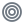
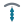
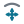
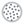
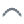

# Transducer Parameters

These parameters define the transducer (from the equipment library or by hand), its drive, and its steering. The calibration fits read their own config: [Calibration Parameters](doc_parameters_calibration.md).

On this page:

- [Transducer Specification (`transducer`)](#transducer-specification-transducer): ISPPA target, transducer type, frequency, library entry, and positions.

## Transducer Specification (`transducer`)

See [Transducer Definition](doc_transducer.md).

Except `target_isppa_wcm2` (default `30`), the fields have no defaults and must be set in the study config or come from the equipment library (`serial`).

| **Parameter** | **Description** | **Comments** |
|---|---|---|
| `target_isppa_wcm2` | Target free-water ISPPA [W/cm²] of this transducer alone. | Default `30`. Scalar: the field is scaled to it (needs a free-water baseline; see `modules.run_water_baseline`). Vector: one thermal job per value ([multi-intensity](doc_multiintensity.md)). Empty `[]`: no scaling, the field is reported at `elem_p_amp`. Several transducers: each transducer's own target; coherent runs set each drive before the simulation, async runs scale each field before combining (see [Multi-transducer: ISPPA targets](doc_multitransducer.md#isppa-targets)). |
| `type` | Type of transducer array. | { .choice-icon } `annular` / { .choice-icon } `matrix`. Mandatory. |
| `freq_hz` | Fundamental frequency [Hz]. | Shared across all elements. |
| `serial` | Equipment serial; geometry, phases, and drive come from the equipment config and transducer library. | See [Transducer Library](doc_transducer_library.md). Values set in the study config take precedence. |
| `combo.ds_serial` | Driving-system serial. | Selects the calibration entry for `<serial>` with this driving system; without it only the driving-system-agnostic entry is looked up. |
| `library_path` | Folder with your own library entries. | Calibration entries there are used when one exists for this combo, otherwise the shipped `config/calibration/` (with a warning). Equipment entries there (`*_transducer.yaml`, `*_driver.yaml`) add transducers or replace shipped ones. See [Your own transducers and calibrations](doc_transducer_library.md#your-own-transducers-and-calibrations). |
| `max_elem_p_amp` | Largest drive your driving system delivers [Pa, as `elem_p_amp`]. | Empty = the `drive_limit` of the combo in the equipment entry, if any. A library drive above it warns (`resolve_transducer_from_serial:driveLimit`) with the largest ISPPA reachable at that depth. See [Drive limits](doc_transducer_library_shipped.md#drive-limits). |
| `condition` | **Experimental, not validated.** Dephased library condition (`conditions.<label>` in the library entry). | Replaces the focal-depth lookup; `focal_distance_ep` defaults to the condition's nominal setpoint. See [Dephased conditions](doc_transducer_library.md#dephased-conditions). |
| `timing_offset_s` | Async `custom` schedule: delay of this transducer's first pulse [s]. | Empty = `0`. See [Firing Schedule](doc_multitransducer_async.md#firing-schedule). |
| `timing.pd`, `timing.pri`, `timing.ptd`, `timing.ptri`, `timing.ptrd` | Async `custom` schedule: this transducer's pulse and train timing and its sonication duration [s], replacing the `timing` block's. | Empty = the `timing` block's. Read only by `custom`; with another schedule they are an error. |
| `trans_pos` | Transducer position (XYZ, bowl apex). | T1 voxels by default; RAS+ or MNI mm via `placement.manual.coordinate_space`. |
| `focus_pos` | Focus (target) position (XYZ). | T1 voxels by default; RAS+ or MNI mm via `placement.manual.coordinate_space`. |
| `focal_distance_ep` | Focal depth setting: the depth the device is set to focus at, from the exit plane [mm]. | For annular arrays it selects the library phases and drive, so the simulated focus lands here whatever the `trans_pos`→`focus_pos` distance (the planned target depth). Empty = that distance minus `focal_distance_offset` (`focal_distance_calculation`). |
| `focal_distance_bowl` | Focal depth setting from the bowl apex [mm]. | `focal_distance_ep` + bowl-to-exit-plane offset; set either. |
| `focal_distance_offset` | Offset between transducer bowl and exit plane [mm]. | **Derived** from `curv_radius_mm − dist_geom_ep_mm`. Not set by user. |

### Annular Array Definition (`annular`)

| **Parameter** | **Description** | **Comments** |
|---|---|---|
| `elem_p_amp` | Pressure amplitude [Pa]; scalar or one value per element. | Advanced: from calibration. Empty with a target ISPPA: a nominal drive scaled to it. `elem_amp` is the deprecated name (renamed on load with a warning). |
| `elem_phase_deg` | Source phase per element [degrees]. | Advanced: from calibration. Empty: steered to `focal_distance_ep` (geometric phases for custom geometry). |
| `elem_n` | Number of transducer elements. | |
| `elem_id_mm` | Inner diameter of each element [mm]. | |
| `elem_od_mm` | Outer diameter of each element [mm]. | |
| `curv_radius_mm` | Radius of curvature of the transducer bowl [mm]. | `Inf` (YAML `.inf`) = flat element, e.g. a plane piston: its face at `trans_pos` is the exit plane; needs `grid.use_kWaveArray: 1`, in 3D a single disc. See [Flat elements](doc_transducer.md#flat-elements). |
| `dist_geom_ep_mm` | Distance from geometric focus to transducer plane [mm]. | If not provided, the exit plane is the bowl rim: √(`curv_radius_mm`² − (max(`elem_od_mm`)/2)²) (`Inf` for flat elements). |
| `depth_mm` | Transducer depth [mm]. | Visualization only. |

### Matrix Array Definition (`matrix`)

| **Parameter** | **Description** | **Comments** |
|---|---|---|
| `elem_p_amp` | Pressure amplitude [Pa]; scalar or one value per element. | Advanced: from calibration. Empty with a target ISPPA: a nominal drive scaled to it. `elem_amp` is the deprecated name (renamed on load with a warning). |
| `depth_mm` | Transducer depth [mm]. | Visualization only. |
| `steering` | Steering mode of the transducer. | { .choice-icon } `1D` = axial only, { .choice-icon } `3D` = volumetric steering. |
| `elem_shape` | Shape of individual elements. | Options: { .choice-icon } `rect`, { .choice-icon } `disc`, { .choice-icon } `bowl`. Element area is defined using the rectangular dimensions and projected onto the selected shape, unless `elem_diameter_mm` is set. |
| `elem_height_mm` | Element height [mm], along y. | `rect` elements: size along y; `disc`/`bowl`: sets the equal-area diameter. |
| `elem_width_mm` | Element width [mm], along x. | `rect` elements: size along x; `disc`/`bowl`: sets the equal-area diameter. |
| `elem_diameter_mm` | Aperture diameter of `disc`/`bowl` elements [mm]. | Optional. Empty = equal-area diameter from `elem_width_mm` × `elem_height_mm` (flat disc area for `disc`, spherical-cap area for `bowl`). Also sets the element size in the transducer mask. |
| `elem_phase_override_deg` | Calibrated per-element phases [deg]. | Optional, one value per element (after Clover replication). Replaces the geometric steering phases toward `focus_pos`; element orientation is unchanged. Empty = geometric steering. |
| `use_steering_correction` | Scale the element drive by the steering correction k(target). | Default `true`. Used when the transducer library (or `steering_correction`) holds one; see [Steering correction of matrix arrays](doc_calibration_matrix-steering.md#steering-correction-of-matrix-arrays). |
| `steering_correction` | Steering correction given inline. | Optional struct as written by `build_steering_correction`. Empty = from the transducer library. |
| `outer_diameter_mm` | Outer diameter of the transducer [mm]. | Defines active aperture boundary. |
| `is_curved` | Whether the array has a curved surface. | `false` = flat array: every element faces +z, `curv_radius_mm` is not used, `elem_shape` must be `rect` or `disc`. |
| `curv_radius_mm` | Radius of curvature (ROC) of the transducer bowl [mm]. | Defines natural focus. Depends on `is_curved`. |
| `dist_geom_ep_mm` | Distance from geometric focus to transducer plane [mm]. | If not provided, the exit plane is the bowl rim: √(`curv_radius_mm`² − (`outer_diameter_mm`/2)²). Depends on `is_curved`. |
| `is_clover_setup` | Enables Clover (multi-array) configuration. | Replicates array into multiple leaves. |
| `matrix_shape.type` | Method used to define element positions. | Options: `define_here`, `extract_from_file`. |

#### Matrix: Clover (`clover`)

| **Parameter** | **Description** | **Comments** |
|---|---|---|
| `n_leaves` | Number of Clover leaves. | Any positive integer; one leaf stays on the parent axis unless `elevation_deg` is set. |
| `ROC_parent` | Radius of curvature of the combined Clover setup [mm]. | Can differ from individual array ROC; elements then point at their own leaf's natural focus. |
| `az_sep_deg` | Azimuthal separation between adjacent leaves [deg]. | Optional. Empty = `360 / n_leaves`. `n_leaves × az_sep_deg` must not exceed 360. |
| `elevation_deg` | Tilt of each leaf from the parent axis [deg]. | Optional. Empty = smallest tilt at which adjacent leaf centres are one `outer_diameter_mm` apart on the parent bowl. |

#### Matrix: Grid Distribution (`define_here`)

Warning: The `define_here` options are experimental and may contain bugs due to limited testing time.

| **Parameter** | **Description** | **Comments** |
|---|---|---|
| `grid_shape.type` | Grid distribution type. | Options: { .choice-icon } `rect`, { .choice-icon } `fibonacci`, { .choice-icon } `fermat`. |

**Rectangular Grid**

| **Parameter** | **Description** | **Comments** |
|---|---|---|
| `elem_n_row` | Number of element rows (along y). | Row pitch: `elem_height_mm + elem_spacing_height_mm`. |
| `elem_n_col` | Number of element columns (along x). | Column pitch: `elem_width_mm + elem_spacing_width_mm`. Elements whose centre lies outside `outer_diameter_mm` are dropped. |
| `elem_spacing_height_mm` | Spacing between elements in height direction [mm]. | Edge-to-edge spacing. |
| `elem_spacing_width_mm` | Spacing between elements in width direction [mm]. | Edge-to-edge spacing. |
| `sparsity_factor` | Fraction of active elements. | Range: 0.1–1.0. Validated but **not applied** yet: all elements in the grid are used. |

**Fibonacci Grid**

| **Parameter** | **Description** | **Comments** |
|---|---|---|
| `elem_n` | Total number of elements. | |
| `kerf_mm` | Minimum spacing between elements [mm]. | |

**Fermat Grid**

| **Parameter** | **Description** | **Comments** |
|---|---|---|
| `elem_n` | Total number of elements. | Uses spiral distribution. |

#### Matrix: File Extraction (`extract_from_file`)

| **Parameter** | **Description** | **Comments** |
|---|---|---|
| `file_path` | Path to coordinate file. | Must contain (x, y, z) [mm]. Curved array: origin at the centre of curvature, z towards the array. Flat array: origin at the array centre, z along the beam. |
| `start_row` | Row index where data starts. | MATLAB may skip header row. |
| `start_col` | Column index where data starts. | |
| `rot_col` | Column with each element's rotation about its own normal [deg]. | Optional. For rectangular elements laid out in different orientations (e.g. `90` = turned on its side). Empty = all elements as `elem_width_mm` × `elem_height_mm` along x × y. |
| `elem_n` | Number of elements to extract. | Can exceed final active count. |
| `select_random_subset` | Enable random subset selection. | Useful for sparse arrays. |
| `subset.random_seed` | Controls reproducibility of subset. | `false` or empty = the same subset every run; `true` = a new subset each run, with its seed printed in the log. |
| `subset.subset_n_elements` | Number of elements in subset. | Must be ≤ total elements. |
| `project_on_new_ROC` | Project elements onto new curvature. | May introduce unrealistic layouts. |
| `ROC_projection.new_ROC_mm` | New radius of curvature [mm]. | Used when projection enabled. |
